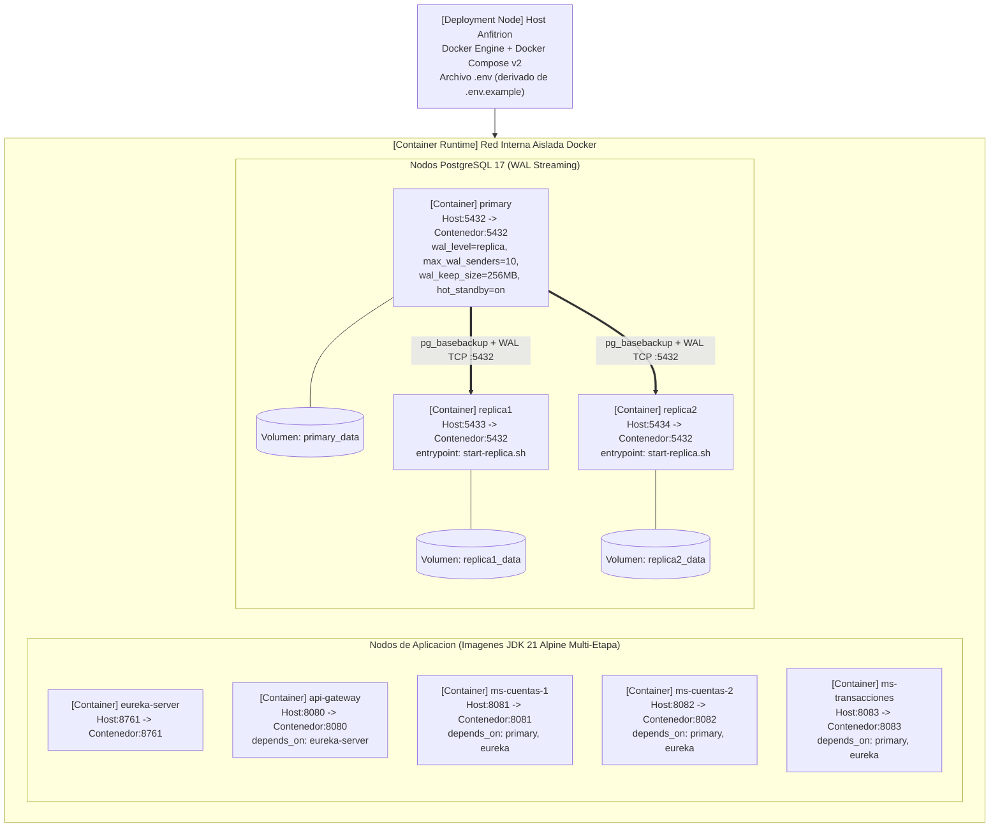

# Informe de Arquitectura y Verificación — Billetera Digital Distribuida

Este informe reúne en un solo documento la explicación sistemática del sistema desplegado y la verificación experimental de los ocho escenarios obligatorios `P01`–`P08`. Está escrito para leerse **sin acceso al repositorio**: los criterios, el procedimiento, los requisitos y toda la evidencia se reproducen aquí como texto literal, con su fecha y su ruta de origen.

## Cómo leer este informe

1. **§2 Arquitectura**: pegar el diagrama C4 en el marcador indicado y usar las tablas para entender componentes, puertos, comunicaciones, descubrimiento y persistencia.
2. **§3 Pruebas**: la matriz resumen da el veredicto de cada escenario; la matriz detallada contiene objetivo, procedimiento, resultado esperado, resultado obtenido, evidencia y análisis.
3. **§4 Evidencias**: citas textuales de las dos ejecuciones reales (`E` = 24/11, `C` = 19/11). Los identificadores `E##` y `C##` se usan dentro de las matrices.

---

NOTA: **Este proyecto es producto de una actividad en clases**

El link al video de presentación se encuentra en:

> https://drive.google.com/file/d/10-gmY0eYT0AMnLySES2HSBplX-U6U11E/view?usp=sharing


## 1. Fuentes, entorno y convenciones

### 1.1 Fuentes documentales

| ID | Documento de origen | Fecha | Qué aporta a este informe |
|---|---|---|---|
| `SAD-05` | `docs/sad/05-despliegue-e-infraestructura.md` | — | Diagrama C4 de despliegue, secuencia de arranque, parametrización y seguridad |
| `SRS-CRIT` | `docs/srs/06-verificacion-y-trazabilidad/01-criterios-aceptacion-p01-p08.md` | — | Objetivo, procedimiento, precondiciones y criterios de aceptación de `P01`–`P08` |
| `SRS-OBL` | `docs/srs/06-verificacion-y-trazabilidad/03-pruebas-obligatorias-p01-p08.md` | — | Enunciado obligatorio y evidencias exigidas por escenario |
| `SRS-TRAZ` | `docs/srs/06-verificacion-y-trazabilidad/02-matriz-trazabilidad.md` | — | Relación entre requisitos `RF`/`RNF` y escenarios |
| `R24` | `reportes/reporte-20261124-002459.md` | **2026-11-24 00:24:59** | Respuestas HTTP reales con cabeceras y cuerpo; bitácora de la sesión. Citado como `E01`–`E20` |
| `C19` | `docs/api/evidencia-p01-p08.md` | **2026-11-19** | Salida literal de `docs/api/curl-p01-p08.sh` (31 OK, 0 fallas). Citado como `C01`–`C08` |

`R24` es la fuente principal de *resultado obtenido* porque contiene las respuestas HTTP completas. `C19` se usa para acreditar extremos que `R24` no capturó (lote único de 120 peticiones, comprobante crítico, estado `streaming` de PostgreSQL y retorno al *Round-Robin*). **No se mezclan cifras de una ejecución con otra**: cada cita lleva su fecha y su entorno.

### 1.2 Entorno de cada ejecución

| Ejecución | Fecha | Modo | Gateway / Eureka | Direcciones observadas | Saldos de prueba |
|---|---|---|---|---|---|
| `R24` | 2026-11-24 00:24:59 | En vivo real, generado por `presentacion-web` | `http://localhost:8080` / `http://localhost:8761` | `10.89.13.3` (primary), `.5` (R2), `.6` (gateway), `.7` (c1), `.8` (tx), `.10` (c2), `.11` (R1) | Origen `0991112233`, destino `0984445566`; saldo origen observado 225 → 200 |
| `C19` | 2026-11-19 | Script `curl-p01-p08.sh` sobre despliegue limpio | `http://localhost:8080` / `http://localhost:8761` | `10.89.13.2` (primary), `.5`/`.6` (réplicas) | Origen `0991112233` 500.00 → 475.00, destino 150.00 → 175.00 |

`C19` declara además: Fedora Linux 44 (x86_64, 8 CPU, 15 GB RAM), Podman 5.8.7, Docker Compose 5.6.0, `docker compose down -v && docker compose up -d --build`, los 8 contenedores en `healthy` y Flyway con *advisory lock* (una instancia aplicó `V1`/`V2`, la otra informó `Schema "cuentas_db" is up to date. No migration necessary.`).

### 1.3 Convención de citas y glosario

Toda evidencia se identifica con `E##` (reporte `R24`) o `C##` (log `C19`) y se transcribe literalmente en §4. Un `...` dentro de un bloque indica únicamente líneas repetidas omitidas; nunca altera los valores citados.

| Marca | Significado |
|---|---|
| `x-gateway-handled` | La petición fue enrutada por `api-gateway` |
| `x-service-instance` / `servicioOrigen` | Instancia del microservicio que atendió la petición |
| `instanciaCuentasConsultada` | Instancia de `ms-cuentas` localizada por descubrimiento durante una transferencia |
| `x-db-node` / `nodoBaseDatos` | Nodo PostgreSQL usado, con su IP, puerto y flag `recovery` |
| `recovery=true` / `false` | `true` = réplica en modo *hot standby*; `false` = primario |
| `x-db-fallback` | `true` = la selección normal falló y se redirigió a otra réplica |
| `politicaEnrutamiento` | `ESCRITURA_DIRECTA`, `ROUND_ROBIN_REPLICA`, `LECTURA_CRITICA_PRIMARIO` o `FAILOVER_REPLICA` |
| `available` / `consecutiveSuccesses` / `lastReplayLsn` | Estado del *ReplicaHealthTracker*: disponibilidad, sondeos consecutivos y último LSN aplicado |
| `queriesServed` (`consultasTotales`) | Contador de consultas atendidas por nodo |

---

## 2. Arquitectura del sistema desplegado


### 2.1 Diagrama C4 de despliegue



---

El despliegue es un único host con Docker Engine y Docker Compose v2, con un archivo `.env` derivado de `.env.example`. Dentro de la red interna aislada conviven ocho contenedores: cinco nodos de aplicación construidos con imágenes JDK 21 Alpine multi-etapa y tres nodos PostgreSQL 17 con replicación por *WAL streaming*.

### 2.2 Componentes y puertos

| Nodo | Rol | Publicación host → contenedor | Dependencias | Responsabilidad |
|---|---|---|---|---|
| `eureka-server` | Registro y descubrimiento | `8761 → 8761` | — | Catálogo de servicios, latidos y bajas |
| `api-gateway` | Punto de entrada HTTP | `8080 → 8080` | `eureka-server` | Enrutamiento `lb://`, balanceo y reintentos de `GET` |
| `ms-cuentas-1` | Servicio de cuentas (instancia A) | `8081 → 8081` | `primary`, `eureka` | `cuentas_db`: saldos, contactos, `/instancia`, lecturas críticas |
| `ms-cuentas-2` | Servicio de cuentas (instancia B) | `8082 → 8082` | `primary`, `eureka` | Ídem; ejecuta además su propio `ReplicaHealthTracker` |
| `ms-transacciones` | Orquestación P2P | `8083 → 8083` | `primary`, `eureka` | `tx_db`: transferencias, historial y comprobantes |
| `primary` | PostgreSQL 17 primario | `5432 → 5432` | Volumen `primary_data` | Escrituras y emisión de WAL |
| `replica1` | PostgreSQL 17 réplica | `5433 → 5432` | `primary`, volumen `replica1_data` | Lecturas ordinarias en *Round-Robin* |
| `replica2` | PostgreSQL 17 réplica | `5434 → 5432` | `primary`, volumen `replica2_data` | Lecturas ordinarias y failover |

El primario se inicializa con `wal_level=replica`, `max_wal_senders=10`, `wal_keep_size=256MB` y `hot_standby=on`. Cada réplica usa `start-replica.sh`, que espera en bucle a que `pg_basebackup` complete una copia física limpia cuando `$PGDATA/PG_VERSION` no existe.

### 2.3 Comunicaciones

| Origen | Destino | Protocolo / puerto | Propósito | Evidencia |
|---|---|---|---|---|
| Cliente (curl, interfaz web) | `api-gateway` | HTTP REST `:8080` | Único punto de entrada; sin rutas fijas a contenedores | `E02`, `E07`, `C01` |
| `api-gateway` | `ms-cuentas-1` / `-2` | `lb://ms-cuentas` → `:8081`/`:8082` | Balanceo Round-Robin de `GET` | `E02`, `E04`, `E06`, `C02` |
| `api-gateway` | `ms-transacciones` | `lb://ms-transacciones` → `:8083` | Transferencias, historial, comprobantes | `E07`, `E13` |
| `ms-transacciones` | `ms-cuentas` | HTTP vía nombre lógico descubierto en Eureka | Consulta de cuenta origen/destino durante la transferencia | `E07`, `E08`, `C04` |
| Los 5 nodos Java | `eureka-server` | HTTP `:8761` | Registro, renovación (5 s) y expiración (12 s) | `E01`, `E03`, `E05` |
| `primary` | `replica1`, `replica2` | TCP `:5432` (`pg_basebackup` + WAL) | Sincronización física y transmisión de WAL | `C05`, `C08` |
| Microservicios | PostgreSQL | JDBC/Hikari | Escrituras en `primary`, lecturas en réplicas o primario según política | `E07`, `E12`, `E14`, `E19` |

### 2.4 Descubrimiento dinámico

El catálogo de `R24` reporta `apps__hashcode = UP_4_` y cuatro instancias `UP`:

| Servicio | `instanceId` | Dirección y puerto | Estado |
|---|---|---|---|
| `API-GATEWAY` | `api-gateway:7027a94f55b23fcae657e87b0b514026:8080` | `10.89.13.6:8080` | `UP` |
| `MS-TRANSACCIONES` | `ms-transacciones:0c59513f1dad5970d7ae01af9489bffc:8083` | `10.89.13.8:8083` | `UP` |
| `MS-CUENTAS` | `ms-cuentas-2:8082` | `10.89.13.10:8082` | `UP` |
| `MS-CUENTAS` | `ms-cuentas-1:8081` | `10.89.13.7:8081` | `UP` |

Cada instancia renueva su arrendamiento cada `renewalIntervalInSecs = 5` con una duración de `durationInSecs = 12`. El Gateway resuelve `lb://ms-cuentas` y `lb://ms-transacciones` contra ese catálogo, por lo que las peticiones funcionales llegan a destino sin configurar direcciones de contenedor (`E01`, `E02`, `E12`). Durante una transferencia, `ms-transacciones` usa el mismo mecanismo para localizar una instancia de `ms-cuentas`: el campo `instanciaCuentasConsultada` de `E07` y `E08` alterna entre `ms-cuentas-1:8081` y `ms-cuentas-2:8082`.

`C19` documenta un ajuste operativo relevante: `eureka-server` publica las bajas sin la caché de solo lectura de 30 s (`use-read-only-response-cache: false`) y el Gateway reintenta solo `GET` ante errores de conexión, con `connect-timeout` de 2 s; los `POST` nunca se reintentan.

### 2.5 Flujo de persistencia y enrutamiento de base de datos

| Política | Nodo seleccionado | Cuándo se aplica | Evidencia |
|---|---|---|---|
| `ESCRITURA_DIRECTA` | `PRIMARY` (`recovery=false`) | `POST /api/transacciones/transferir` y cualquier mutación | `E07`, `E08`, `E09`–`E11` |
| `ROUND_ROBIN_REPLICA` | `REPLICA_1` / `REPLICA_2` (`recovery=true`) | Lecturas ordinarias: `/contactos`, `/historial`, `/instancia` | `E02`, `E04`, `E06`, `E12`, `E13`, `E19` |
| `LECTURA_CRITICA_PRIMARIO` | `PRIMARY` (`recovery=false`) | `/saldo-critico`, `/comprobante/{codigo}` y header `X-Consistencia: CRITICA` | `E14`, `C07` |
| `FAILOVER_REPLICA` | Réplica superviviente | Caída de `replica1` detectada antes de la selección | `E16`, `C06` |

La política crítica existe por la replicación asíncrona: sin ella, una lectura inmediatamente posterior a la transferencia podría mostrar un saldo desactualizado. El `ReplicaHealthTracker` de cada instancia sondea las réplicas, marca `available=false` cuando la conexión expira (en `R24`: `hikari-replica_1 - Connection is not available, request timed out after 2000ms`) y solo las reincorpora tras dos sondeos consecutivos. `E19` y `E20` muestran ese ciclo completo con `consecutiveSuccesses`, `lastReplayLsn` y `queriesServed`.

La coherencia del esquema ante el arranque simultáneo de `ms-cuentas-1` y `ms-cuentas-2` se resuelve con Flyway sobre `PRIMARY` mediante un *PostgreSQL advisory lock*: una instancia aplica `V1__`/`V2__` y la otra valida sin errores de unicidad.

### 2.6 Arranque, dependencias y seguridad

El grafo de arranque es determinístico: `primary` alcanza `healthy` (`pg_isready -U admin -d laboratorio`) → `replica1` y `replica2` ejecutan `pg_basebackup` y entran en *hot standby*; `eureka-server` alcanza `healthy` (`GET /actuator/health`) → los microservicios aplican/validan Flyway y se registran → `api-gateway` queda listo para tráfico. Esto sostiene `RNF-10`: un solo comando `docker compose up -d --build` deja el sistema operativo.

Las credenciales (`POSTGRES_PASSWORD`, `REPLICATION_PASSWORD`, `CUENTAS_DB_PASSWORD`, `TX_DB_PASSWORD`) se externalizan en `.env`, ignorado por Git y documentado con plantilla en `.env.example`. El principio de mínimo privilegio se aplica en SQL: `cuentas_user` solo opera `cuentas_db`, `tx_user` solo `tx_db` y `replicator` posee únicamente `REPLICATION LOGIN`.

---

## 3. Informe de pruebas P01–P08

### 3.1 Matriz resumen

| Escenario | Objetivo (SRS-CRIT) | Requisitos | Veredicto | Evidencias clave |
|---|---|---|---|---|
| `P01` | Descubrimiento dinámico | `RF-10`, `RF-11` | **CONFORME** | `E01`, `E02`, `E12`, `E13`, `C01` |
| `P02` | Balanceo HTTP | `RF-11`, `RNF-01` | **CONFORME** | `E02`, `E04`, `E06`, `C02` |
| `P03` | Fallo de instancia | `RF-10`, `RNF-02` | **CONFORME** | Bitácora `R24`, `C03` |
| `P04` | Comunicación entre servicios | `RF-04`, `RF-06`, `RF-12` | **CONFORME** | `E07`–`E11`, `E13`, `C04` |
| `P05` | Enrutamiento de base de datos | `RF-01`, `RF-02`, `RF-07`, `RNF-05`, `RNF-07` | **CONFORME** | `E02`, `E07`, `E12`, `E13`, `E19`, `C05` |
| `P06` | Fallo de réplica PostgreSQL | `RNF-03` | **CONFORME** | `E15`–`E19`, `C06` |
| `P07` | Consistencia de lectura | `RF-03`, `RF-08`, `RNF-06` | **CONFORME** | `E14`, `C07` |
| `P08` | Recuperación de réplica | `RNF-04`, `RNF-08` | **CONFORME** | `E20`, `C08` |

### 3.2 Matriz detallada

| ID | Objetivo | Procedimiento | Resultado esperado | Resultado obtenido | Evidencia | Análisis |
|---|---|---|---|---|---|---|
| **P01** | Verificar que las instancias se registran en Eureka y se localizan por nombre lógico | 1. `GET http://localhost:8761/eureka/apps` con `Accept: application/json`.<br>2. Solicitudes funcionales vía Gateway: `GET /api/cuentas/0991112233` y `GET /api/transacciones/historial/0991112233` | `MS-CUENTAS` con 2 instancias `UP` (`8081`, `8082`); `MS-TRANSACCIONES` con 1 instancia `UP` (`8083`); peticiones vía `:8080` con `200 OK` sin rutas fijas | Catálogo `UP_4_` con 4 instancias `UP`: Gateway `:8080`, `MS-TRANSACCIONES :8083`, `MS-CUENTAS :8081` y `:8082`. Renovación 5 s / duración 12 s. Peticiones vía Gateway con `200` | `E01`, `E03`, `E05`, `E02`, `E12`, `E13`; `C01` | Conforme. El catálogo incluye también al propio Gateway, además de los dos servicios de negocio exigidos. Las respuestas funcionales muestran `x-gateway-handled: api-gateway` |
| **P02** | Ejecutar al menos 100 solicitudes contra un servicio con dos instancias y registrar cuál responde | 1. Lanzar 100 o más `GET /api/cuentas/instancia` vía Gateway.<br>2. Contabilizar `X-Service-Instance` / `servicioOrigen` en cada respuesta | 100/100 respuestas `HTTP 200`; distribución aproximada 50/50, nunca 100/0 | `R24`: tres lotes de 20/20 `200` (00:06:03, 00:08:37, 00:09:20) con alternancia `ms-cuentas-1:8081` ↔ `ms-cuentas-2:8082`. `C19`: 120/120 `200`, reparto exacto 60/60 | `E02`, `E04`, `E06`; bitácora `R24`; `C02` | Conforme. `R24` no registró un único lote de 100 peticiones, pero `C02` acredita literalmente el criterio de 120/120 con reparto equitativo; ambas ejecuciones coinciden en 0 errores |
| **P03** | Detener una instancia y comprobar continuidad mediante la otra | 1. Registrar tráfico normal.<br>2. `docker compose stop ms-cuentas-2` durante la ráfaga.<br>3. Medir errores y detección.<br>4. `docker compose start ms-cuentas-2` y medir el retorno | El sistema sigue atendiendo mediante `ms-cuentas-1` tras la detección; al reiniciar, la instancia vuelve a registrarse y al balanceo | `R24`: tres corridas; la última con 211 peticiones, 0 errores, convergencia en 0.21 s y retorno de ~25 s (JVM). `C19`: 171 peticiones, 0 errores, convergencia 8934 ms, retorno 26237 ms | Bitácora `R24` (00:14:36–00:18:17), resumen §2; `C03` | Conforme. La ventana de detección observada va de 0.21 s a 8.934 s según ejecución, sin errores al cliente. Tras reincorporarse, `R24` registró `c1=159, c2=52`: participa en el balanceo, aunque el reparto no vuelve de inmediato a 50/50 |
| **P04** | Ejecutar una operación de negocio que requiera una llamada real entre microservicios mediante descubrimiento | 1. `POST /api/transacciones/transferir` con `$25.00`.<br>2. Repetir con monto superior al saldo o al límite diario | Éxito: `201 Created`, descuento origen, acreditación destino, persistencia en `tx_db.transacciones` y `instanciaCuentasConsultada`. Error: `400`/`409` controlado sin alterar saldos | `201` para `TX-2026-0012` (saldo 225, vía `ms-cuentas-1`) y `TX-2026-0013` (saldo 200, vía `ms-cuentas-2`); `409` “Limite diario excedido” ×2 y `409` “Saldo insuficiente” (9999). Todas con `PRIMARY recovery=false` y `ESCRITURA_DIRECTA`. `C19`: 500.00 → 475.00 y 150.00 → 175.00; rechazo sin cambiar saldos | `E07`–`E11`, `E13`; `C04` | Conforme. Cada comprobante exitoso aparece en `/historial` con estado `EXITOSA` y los rechazos con `RECHAZADA`, lo que acredita la persistencia. `R24` verifica saldos por API/auditoría; `C04` los verifica numéricamente antes y después |
| **P05** | Demostrar que las escrituras usan el primario y las consultas ordinarias se reparten entre las réplicas | 1. Ejecutar una transferencia.<br>2. 20 consultas ordinarias entre `/contactos` y `/historial`.<br>3. Consultar `/api/cuentas/db/estado` y logs | Escritura con `nodoBaseDatos` en `PRIMARY` (`recovery=false`); lecturas con `recovery=true` y reparto equilibrado entre `REPLICA_1` y `REPLICA_2` con sus IPs | Escritura en `PRIMARY (10.89.13.3:5432, recovery=false)`. Lecturas en `REPLICA_1 (10.89.13.11)` y `REPLICA_2 (10.89.13.5)` con `recovery=true`; lote de 20/20 sin fallback; `/db/estado` con `REPLICA_2=362`, `REPLICA_1=344`, `PRIMARY=6`. `C19`: 2 réplicas en `streaming` y reparto 9/11 | `E02`, `E04`, `E06`, `E07`, `E12`, `E13`, `E19`; `C05` | Conforme. `R24` no capturó la salida de `pg_stat_replication` (precondición del escenario), pero `C05` la aporta literalmente; el `lastReplayLsn` igual en `E19` es coherente con dos réplicas sincronizadas |
| **P06** | Detener una réplica y comprobar que las consultas continúan por la restante | 1. `docker compose stop replica1`.<br>2. Lanzar de inmediato consultas `/contactos` y `/historial`.<br>3. Consultar `/db/estado` y logs del `ReplicaHealthTracker` | Consultas `200 OK` usando `REPLICA_2` con 0 fallos al cliente; `REPLICA_1 available=false` y `REPLICA_2 available=true` | Tras el `stop` (00:18:27), contactos `200` en `REPLICA_2` (58 ms) e historial `200` en `REPLICA_2` (2043 ms) con `x-db-fallback: true`; lote de 20/20 con `fb=1` y 0 errores. `/db/estado`: `REPLICA_1 available=false`, timeout Hikari de 2000 ms; `REPLICA_2 available=true`, 1414 sondeos. `C19`: 20/20 con 2 fallback | `E15`–`E19`; bitácora `R24` (00:18:27–00:20:15); `C06` | Conforme. El primer acceso tras la caída tardó ~2 s en el historial, pero no produjo error al cliente; el indicador `FAILOVER_REPLICA` confirma la política aplicada |
| **P07** | Crear un registro y consultarlo de inmediato mediante una operación crítica dirigida al primario | 1. `POST /transferir` descontando `$25.00`.<br>2. En la siguiente petición secuencial, `GET /saldo-critico` y `GET /comprobante/{codigo}`.<br>3. Opcionalmente `GET /api/cuentas/{origen}` con `X-Consistencia: CRITICA` | Saldo descontado y comprobante visible sin esperar propagación; `recovery=false` y `politicaEnrutamiento = LECTURA_CRITICA_PRIMARIO` | `R24`: transferencia `201` (`TX-2026-0013`, saldo 225 → 200) y `saldo-critico` `200` con `saldo=200`, `consumidoHoy=300`, `PRIMARY (10.89.13.3:5432, recovery=false)`, `LECTURA_CRITICA_PRIMARIO`. `C19`: comprobante `TX-2026-0004` visible con `200` en `PRIMARY` y header `X-Consistencia: CRITICA` también en `PRIMARY` | `E07`, `E08`, `E14`; `C07` | Conforme combinando fuentes. `R24` acredita RYOW del saldo; `C07` cierra literalmente los dos extremos que faltaban (comprobante inmediato y header crítico), con fecha distinta y declarada |
| **P08** | Reiniciar la réplica detenida, comprobar su recuperación y verificar que vuelve a atender consultas | 1. `docker compose start replica1`.<br>2. Consultar `pg_stat_replication` en el primario.<br>3. Sondear `/db/estado` hasta 2 chequeos exitosos.<br>4. Ejecutar consultas y verificar el contador de `REPLICA_1` | `state = streaming` con WAL sincronizado, más de 2 chequeos `pg_is_in_recovery() = true` y retorno al *Round-Robin* | `R24`: `start replica1` a las 00:20:46; `/db/estado` a las 00:21:28 con `REPLICA_1 available=true`, `consecutiveSuccesses=11`, `lastReplayLsn=0/50A51C0` igual en ambas. `C19`: `state=streaming` con `sent_lsn=replay_lsn=0/505A698` y 9 de 20 lecturas de vuelta en `REPLICA_1` | `E20`; bitácora `R24` (00:20:46–00:21:28); `C08` | Conforme combinando fuentes. `R24` acredita la reincorporación por sondeos y LSN alineado; `C08` aporta el `pg_stat_replication` y el retorno al *Round-Robin* que el reporte no capturó |

### 3.3 Trazabilidad requisitos ↔ escenarios

| Requisito | Descripción | Escenarios | Verificado por |
|---|---|---|---|
| `RF-01` | Consulta ordinaria de cuenta y saldo | `P01`, `P02`, `P05` | `E01`, `E02`, `C02`, `C05` |
| `RF-02` | Consulta de contactos frecuentes | `P05`, `P06` | `E12`, `E15`, `E17` |
| `RF-03` | Lectura crítica de saldo inmediato | `P07` | `E14`, `C07` |
| `RF-04` | Movimiento interno atómico débito/crédito | `P04`, `P07` | `E07`, `E08`, `C04` |
| `RF-05` | Alta de cuenta y endpoint `/instancia` | `P02`, `P03` | `E02`, `E04`, `E06` |
| `RF-06` | Orquestación de transferencia P2P (`lb://`) | `P04` | `E07`, `E08`, `C04` |
| `RF-07` | Consulta de historial de movimientos | `P05`, `P06`, `P08` | `E13`, `E16`, `E18`, `C08` |
| `RF-08` | Verificación crítica de comprobante | `P07` | `C07` |
| `RF-09` | Observabilidad `/api/db/estado` | `P05`, `P06`, `P08` | `E19`, `E20` |
| `RF-10` | Registro dinámico y evicción en Eureka | `P01`, `P03` | `E01`, `C01`, `C03` |
| `RF-11` | Enrutamiento Gateway por `lb://` | `P01`, `P02`, `P03` | `E02`, `E12`, `C02` |
| `RF-12` | Auditoría real en `ApiResponse<T>` | `P02`–`P08` | `E07`–`E20` |
| `RNF-01` | Balanceo HTTP equitativo (100+ req) | `P02` | `C02` |
| `RNF-02` | Continuidad ante caída de instancia | `P03` | Bitácora `R24`, `C03` |
| `RNF-03` | Failover de réplica sin corte | `P06` | `E16`, `C06` |
| `RNF-04` | Reincorporación segura tras 2 chequeos | `P08` | `E20`, `C08` |
| `RNF-05` | `AbstractRoutingDataSource` + AOP pre-TX | `P05`, `P07` | `E07`, `E14`, `C05` |
| `RNF-06` | Consistencia fuerte RYOW post-transferencia | `P07` | `E14`, `C07` |
| `RNF-07` | Distribución Round-Robin en réplicas | `P05`, `P08` | `E19`, `C05`, `C08` |
| `RNF-08` | Aislamiento `cuentas_db`/`tx_db` y WAL | `P04`–`P08` | §2.5, §2.6, `C05`, `C08` |
| `RNF-10` | Reproducibilidad total Docker Compose | `P01`–`P08` | §1.2, §2.6, `C19` |
| `RNF-11` | Trazabilidad real `inet_server_addr()` | `P02`–`P08` | `E02`, `E07`, `E14` |

### 3.4 Límites de la evidencia

- `R24` no contiene un único lote de 100 peticiones para `P02`: registra tres lotes de 20 más una telemetría de 211 peticiones. El cumplimiento literal del criterio se acredita con `C02`.
- `R24` no captura la salida de `pg_stat_replication` ni el incremento del contador de `REPLICA_1` después de `P08`; ambos se acreditan con `C08` y se identifica la instancia que sirvió cada `/db/estado`.
- `R24` no ejecuta `GET /comprobante/{codigo}` ni el header `X-Consistencia: CRITICA`; ambos se acreditan con `C07`.
- Las dos ejecuciones tienen direcciones IP, saldos y tiempos de detección diferentes. Se presentan como mediciones separadas; no se promedian ni se fusionan.

---

## 4. Paquete de evidencias (citas textuales)

### 4.1 Bloque E — reporte `R24`, 2026-11-24 00:24:59

Fuente literal: `reportes/reporte-20261124-002459.md`. Las cabeceras y los cuerpos se transcriben tal cual; en los catálogos e historiales extensos se omiten solo bloques repetidos.

#### E01 · `GET /eureka/apps` · 00:05:13 · HTTP 200 (66 ms)

```json
{
  "applications": {
    "versions__delta": "1",
    "apps__hashcode": "UP_4_",
    "application": [
      ...
        "instance": [
          {
            "instanceId": "api-gateway:7027a94f55b23fcae657e87b0b514026:8080",
            "hostName": "10.89.13.6",
            "app": "API-GATEWAY",
            "ipAddr": "10.89.13.6",
            "status": "UP",
            ...
            "leaseInfo": {
              "renewalIntervalInSecs": 5,
              "durationInSecs": 12,
      ...
        "instance": [
          {
            "instanceId": "ms-transacciones:0c59513f1dad5970d7ae01af9489bffc:8083",
            "hostName": "10.89.13.8",
            "app": "MS-TRANSACCIONES",
            "ipAddr": "10.89.13.8",
            "status": "UP",
      ...
        "instance": [
          {
            "instanceId": "ms-cuentas-2:8082",
            "hostName": "10.89.13.10",
            "app": "MS-CUENTAS",
            "ipAddr": "10.89.13.10",
            "status": "UP",
      ...
          {
            "instanceId": "ms-cuentas-1:8081",
            "hostName": "10.89.13.7",
            "app": "MS-CUENTAS",
            "ipAddr": "10.89.13.7",
            "status": "UP",
      ...
```

#### E02 · `GET /api/cuentas/instancia` · 00:06:03 · HTTP 200 (24 ms)

Cabeceras: `x-gateway-handled: api-gateway` · `x-service-instance: ms-cuentas-1:8081` · `x-db-node: REPLICA_1 (10.89.13.11:5432, recovery=true)` · `x-db-fallback: false`.

```json
{
  "estado": "OK",
  "mensaje": "Instancia operativa",
  "datos": {
    "instancia": "ms-cuentas-1:8081",
    "puerto": 8081,
    "timestamp": "2026-11-24T05:06:03.472914114Z"
  },
  "auditoriaTecnica": {
    "servicioOrigen": "ms-cuentas-1:8081",
    "instanciaCuentasConsultada": null,
    "nodoBaseDatos": "REPLICA_1 (10.89.13.11:5432, recovery=true)",
    "politicaEnrutamiento": "ROUND_ROBIN_REPLICA"
  }
}
```

#### E03 · `GET /eureka/apps` · 00:07:03 · HTTP 200 (8 ms)

Mismo catálogo que `E01`, con `"apps__hashcode": "UP_4_"`.

#### E04 · `GET /api/cuentas/instancia` · 00:08:37 · HTTP 200 (39 ms)

Cabeceras: `x-gateway-handled: api-gateway` · `x-service-instance: ms-cuentas-2:8082` · `x-db-node: REPLICA_2 (10.89.13.5:5432, recovery=true)` · `x-db-fallback: false`.

```json
{
  "estado": "OK",
  "mensaje": "Instancia operativa",
  "datos": {
    "instancia": "ms-cuentas-2:8082",
    "puerto": 8082,
    "timestamp": "2026-11-24T05:08:37.464502169Z"
  },
  "auditoriaTecnica": {
    "servicioOrigen": "ms-cuentas-2:8082",
    "instanciaCuentasConsultada": null,
    "nodoBaseDatos": "REPLICA_2 (10.89.13.5:5432, recovery=true)",
    "politicaEnrutamiento": "ROUND_ROBIN_REPLICA"
  }
}
```

#### E05 · `GET /eureka/apps` · 00:09:19 · HTTP 200 (19 ms)

Mismo catálogo que `E01`, con `"apps__hashcode": "UP_4_"`.

#### E06 · `GET /api/cuentas/instancia` · 00:09:19 · HTTP 200 (12 ms)

Cabeceras: `x-gateway-handled: api-gateway` · `x-service-instance: ms-cuentas-1:8081` · `x-db-node: REPLICA_1 (10.89.13.11:5432, recovery=true)` · `x-db-fallback: false`.

```json
{
  "estado": "OK",
  "mensaje": "Instancia operativa",
  "datos": {
    "instancia": "ms-cuentas-1:8081",
    "puerto": 8081,
    "timestamp": "2026-11-24T05:09:19.787323175Z"
  },
  "auditoriaTecnica": {
    "servicioOrigen": "ms-cuentas-1:8081",
    "instanciaCuentasConsultada": null,
    "nodoBaseDatos": "REPLICA_1 (10.89.13.11:5432, recovery=true)",
    "politicaEnrutamiento": "ROUND_ROBIN_REPLICA"
  }
}
```

#### E07 · `POST /api/transacciones/transferir` · 00:09:32 · HTTP 201 (221 ms)

Cabeceras: `x-gateway-handled: api-gateway` · `x-service-instance: ms-transacciones:8083` · `x-db-node: PRIMARY (10.89.13.3:5432, recovery=false)` · `x-db-fallback: false`.

```json
{
  "celularOrigen": "0991112233",
  "celularDestino": "0984445566",
  "monto": 25,
  "motivo": "Transferencia P2P"
}
```

```json
{
  "estado": "OK",
  "mensaje": "Transferencia realizada con exito",
  "datos": {
    "codigoComprobante": "TX-2026-0012",
    "celularOrigen": "0991112233",
    "celularDestino": "0984445566",
    "monto": 25,
    "motivo": "Transferencia P2P",
    "estado": "EXITOSA",
    "nuevoSaldoOrigen": 225,
    "fechaHora": "2026-11-24T05:09:32.302241Z"
  },
  "auditoriaTecnica": {
    "servicioOrigen": "ms-transacciones:8083",
    "instanciaCuentasConsultada": "ms-cuentas-1:8081",
    "nodoBaseDatos": "PRIMARY (10.89.13.3:5432, recovery=false)",
    "politicaEnrutamiento": "ESCRITURA_DIRECTA"
  }
}
```

#### E08 · `POST /api/transacciones/transferir` · 00:10:59 · HTTP 201 (344 ms)

Cabeceras: `x-gateway-handled: api-gateway` · `x-service-instance: ms-transacciones:8083` · `x-db-node: PRIMARY (10.89.13.3:5432, recovery=false)` · `x-db-fallback: false`.

```json
{
  "estado": "OK",
  "mensaje": "Transferencia realizada con exito",
  "datos": {
    "codigoComprobante": "TX-2026-0013",
    "celularOrigen": "0991112233",
    "celularDestino": "0984445566",
    "monto": 25,
    "motivo": "Transferencia P2P",
    "estado": "EXITOSA",
    "nuevoSaldoOrigen": 200,
    "fechaHora": "2026-11-24T05:10:59.186957Z"
  },
  "auditoriaTecnica": {
    "servicioOrigen": "ms-transacciones:8083",
    "instanciaCuentasConsultada": "ms-cuentas-2:8082",
    "nodoBaseDatos": "PRIMARY (10.89.13.3:5432, recovery=false)",
    "politicaEnrutamiento": "ESCRITURA_DIRECTA"
  }
}
```

#### E09 · `POST /api/transacciones/transferir` · 00:11:03 · HTTP 409 (58 ms)

```json
{
  "estado": "ERROR",
  "mensaje": "Limite diario excedido",
  "datos": null,
  "auditoriaTecnica": {
    "servicioOrigen": "ms-transacciones:8083",
    "instanciaCuentasConsultada": "ms-cuentas-2:8082",
    "nodoBaseDatos": "PRIMARY (10.89.13.3:5432, recovery=false)",
    "politicaEnrutamiento": "ESCRITURA_DIRECTA"
  }
}
```

#### E10 · `POST /api/transacciones/transferir` · 00:11:06 · HTTP 409 (34 ms)

```json
{
  "estado": "ERROR",
  "mensaje": "Limite diario excedido",
  "datos": null,
  "auditoriaTecnica": {
    "servicioOrigen": "ms-transacciones:8083",
    "instanciaCuentasConsultada": "ms-cuentas-1:8081",
    "nodoBaseDatos": "PRIMARY (10.89.13.3:5432, recovery=false)",
    "politicaEnrutamiento": "ESCRITURA_DIRECTA"
  }
}
```

#### E11 · `POST /api/transacciones/transferir` · 00:11:33 · HTTP 409 (90 ms)

```json
{
  "estado": "ERROR",
  "mensaje": "Saldo insuficiente",
  "datos": null,
  "auditoriaTecnica": {
    "servicioOrigen": "ms-transacciones:8083",
    "instanciaCuentasConsultada": "ms-cuentas-1:8081",
    "nodoBaseDatos": "PRIMARY (10.89.13.3:5432, recovery=false)",
    "politicaEnrutamiento": "ESCRITURA_DIRECTA"
  }
}
```

#### E12 · `GET /api/cuentas/0991112233/contactos` · 00:12:47 · HTTP 200 (52 ms)

Cabeceras: `x-gateway-handled: api-gateway` · `x-service-instance: ms-cuentas-1:8081` · `x-db-node: REPLICA_1 (10.89.13.11:5432, recovery=true)` · `x-db-fallback: false`.

```json
{
  "estado": "OK",
  "mensaje": "Contactos frecuentes obtenidos",
  "datos": [
    {
      "celularContacto": "0977778899",
      "alias": "Carla - Oficina"
    },
    {
      "celularContacto": "0984445566",
      "alias": "Luis - Almuerzos"
    }
  ],
  "auditoriaTecnica": {
    "servicioOrigen": "ms-cuentas-1:8081",
    "instanciaCuentasConsultada": null,
    "nodoBaseDatos": "REPLICA_1 (10.89.13.11:5432, recovery=true)",
    "politicaEnrutamiento": "ROUND_ROBIN_REPLICA"
  }
}
```

#### E13 · `GET /api/transacciones/historial/0991112233` · 00:12:47 · HTTP 200 (60 ms)

Cabeceras: `x-gateway-handled: api-gateway` · `x-service-instance: ms-transacciones:8083` · `x-db-node: REPLICA_1 (10.89.13.11:5432, recovery=true)` · `x-db-fallback: false`.

```json
{
  "estado": "OK",
  "mensaje": "Historial obtenido",
  "datos": [
    {
      "codigoComprobante": "TX-2026-0016",
      "celularOrigen": "0991112233",
      "celularDestino": "0984445566",
      "monto": 9999,
      "motivo": "Prueba limite",
      "estado": "RECHAZADA",
      "fechaHora": "2026-11-24T05:11:33.128121Z"
    },
    ...
    {
      "codigoComprobante": "TX-2026-0013",
      "celularOrigen": "0991112233",
      "celularDestino": "0984445566",
      "monto": 25,
      "motivo": "Transferencia P2P",
      "estado": "EXITOSA",
      "fechaHora": "2026-11-24T05:10:59.186957Z"
    },
    ...
  ],
  "auditoriaTecnica": {
    "servicioOrigen": "ms-transacciones:8083",
    "instanciaCuentasConsultada": null,
    "nodoBaseDatos": "REPLICA_1 (10.89.13.11:5432, recovery=true)",
    "politicaEnrutamiento": "ROUND_ROBIN_REPLICA"
  }
}
```

El cuerpo completo contiene 16 comprobantes (`TX-2026-0001` a `TX-2026-0016`), con `TX-2026-0012` y `TX-2026-0013` en estado `EXITOSA`.

#### E14 · `GET /api/cuentas/0991112233/saldo-critico` · 00:13:26 · HTTP 200 (20 ms)

Cabeceras: `x-gateway-handled: api-gateway` · `x-service-instance: ms-cuentas-2:8082` · `x-db-node: PRIMARY (10.89.13.3:5432, recovery=false)` · `x-db-fallback: false`.

```json
{
  "estado": "OK",
  "mensaje": "Saldo critico verificado en nodo primario",
  "datos": {
    "numeroCelular": "0991112233",
    "saldo": 200,
    "limiteDiario": 300,
    "consumidoHoy": 300,
    "consultadoEn": "2026-11-24T05:13:26.631105370Z"
  },
  "auditoriaTecnica": {
    "servicioOrigen": "ms-cuentas-2:8082",
    "instanciaCuentasConsultada": null,
    "nodoBaseDatos": "PRIMARY (10.89.13.3:5432, recovery=false)",
    "politicaEnrutamiento": "LECTURA_CRITICA_PRIMARIO"
  }
}
```

#### E15 · `GET /api/cuentas/0991112233/contactos` · 00:18:28 · HTTP 200 (58 ms)

Cabeceras: `x-gateway-handled: api-gateway` · `x-service-instance: ms-cuentas-1:8081` · `x-db-node: REPLICA_2 (10.89.13.5:5432, recovery=true)` · `x-db-fallback: false`.

```json
{
  "estado": "OK",
  "mensaje": "Contactos frecuentes obtenidos",
  "datos": [
    {
      "celularContacto": "0977778899",
      "alias": "Carla - Oficina"
    },
    {
      "celularContacto": "0984445566",
      "alias": "Luis - Almuerzos"
    }
  ],
  "auditoriaTecnica": {
    "servicioOrigen": "ms-cuentas-1:8081",
    "instanciaCuentasConsultada": null,
    "nodoBaseDatos": "REPLICA_2 (10.89.13.5:5432, recovery=true)",
    "politicaEnrutamiento": "ROUND_ROBIN_REPLICA"
  }
}
```

#### E16 · `GET /api/transacciones/historial/0991112233` · 00:18:30 · HTTP 200 (2043 ms)

Cabeceras: `x-gateway-handled: api-gateway` · `x-service-instance: ms-transacciones:8083` · `x-db-node: REPLICA_2 (10.89.13.5:5432, recovery=true)` · `x-db-fallback: true`.

```json
  "auditoriaTecnica": {
    "servicioOrigen": "ms-transacciones:8083",
    "instanciaCuentasConsultada": null,
    "nodoBaseDatos": "REPLICA_2 (10.89.13.5:5432, recovery=true)",
    "politicaEnrutamiento": "FAILOVER_REPLICA"
  }
```

#### E17 · `GET /api/cuentas/0991112233/contactos` · 00:18:56 · HTTP 200 (667 ms)

Cabeceras: `x-gateway-handled: api-gateway` · `x-service-instance: ms-cuentas-2:8082` · `x-db-node: REPLICA_2 (10.89.13.5:5432, recovery=true)` · `x-db-fallback: false`.

```json
{
  "estado": "OK",
  "mensaje": "Contactos frecuentes obtenidos",
  "datos": [
    {
      "celularContacto": "0977778899",
      "alias": "Carla - Oficina"
    },
    {
      "celularContacto": "0984445566",
      "alias": "Luis - Almuerzos"
    }
  ],
  "auditoriaTecnica": {
    "servicioOrigen": "ms-cuentas-2:8082",
    "instanciaCuentasConsultada": null,
    "nodoBaseDatos": "REPLICA_2 (10.89.13.5:5432, recovery=true)",
    "politicaEnrutamiento": "ROUND_ROBIN_REPLICA"
  }
}
```

#### E18 · `GET /api/transacciones/historial/0991112233` · 00:18:56 · HTTP 200 (28 ms)

Cabeceras: `x-gateway-handled: api-gateway` · `x-service-instance: ms-transacciones:8083` · `x-db-node: REPLICA_2 (10.89.13.5:5432, recovery=true)` · `x-db-fallback: false`.

```json
  "auditoriaTecnica": {
    "servicioOrigen": "ms-transacciones:8083",
    "instanciaCuentasConsultada": null,
    "nodoBaseDatos": "REPLICA_2 (10.89.13.5:5432, recovery=true)",
    "politicaEnrutamiento": "ROUND_ROBIN_REPLICA"
  }
```

#### E19 · `GET /api/cuentas/db/estado` · 00:20:15 · HTTP 200 (14 ms)

```json
{
  "servicio": "ms-cuentas-1:8081",
  "consultasTotales": {
    "REPLICA_2": 362,
    "REPLICA_1": 344,
    "PRIMARY": 6
  },
  "replicas": [
    {
      "nodo": "REPLICA_1",
      "available": false,
      "consecutiveSuccesses": 0,
      "lastReplayLsn": "0/50A51C0",
      "lastError": "hikari-replica_1 - Connection is not available, request timed out after 2000ms (total=0, active=0, idle=0, waiting=0)",
      "lastCheckedAt": "2026-11-24T05:20:10.687598555Z"
    },
    {
      "nodo": "REPLICA_2",
      "available": true,
      "consecutiveSuccesses": 1414,
      "lastReplayLsn": "0/50A51C0",
      "lastError": null,
      "lastCheckedAt": "2026-11-24T05:20:10.688041507Z"
    }
  ]
}
```

#### E20 · `GET /api/cuentas/db/estado` · 00:21:28 · HTTP 200 (29 ms)

```json
{
  "servicio": "ms-cuentas-2:8082",
  "consultasTotales": {
    "PRIMARY": 0,
    "REPLICA_1": 0,
    "REPLICA_2": 5
  },
  "replicas": [
    {
      "nodo": "REPLICA_1",
      "available": true,
      "consecutiveSuccesses": 11,
      "lastReplayLsn": "0/50A51C0",
      "lastError": null,
      "lastCheckedAt": "2026-11-24T05:21:28.722383861Z"
    },
    {
      "nodo": "REPLICA_2",
      "available": true,
      "consecutiveSuccesses": 38,
      "lastReplayLsn": "0/50A51C0",
      "lastError": null,
      "lastCheckedAt": "2026-11-24T05:21:28.722754286Z"
    }
  ]
}
```

#### Bitácora `R24` (extracto literal, sección 4)

```text
00:05:13 [OK  ] [HTTP] GET /eureka/apps -> 200 (66ms)
00:06:03 [OK  ] [HTTP] 20x GET /instancia -> 20/20 OK (513ms)
00:08:37 [OK  ] [HTTP] 20x GET /instancia -> 20/20 OK (470ms)
00:09:20 [OK  ] [HTTP] 20x GET /instancia -> 20/20 OK (473ms)
00:12:48 [OK  ] [HTTP] 20x lecturas R1/R2 -> 20/20 OK fb=0
00:15:38 [OK  ] [FAIL] Convergencia a ms-cuentas-1 (0.64s)
00:16:46 [OK  ] [FAIL] Convergencia a ms-cuentas-1 (0.27s)
00:18:12 [OK  ] [FAIL] Convergencia a ms-cuentas-1 (0.21s)
00:18:17 [OK  ] [FAIL] Resumen S09: 211 req, 0 err, det=0.21s
00:18:27 [WARN] [FAIL] docker compose stop replica1
00:18:30 [OK  ] [HTTP] GET /api/transacciones/historial/0991112233 -> 200 (2043ms)
00:18:31 [OK  ] [FAIL] Failover 20x -> 20/20 OK (0 err) fb=1
00:20:15 [OK  ] [HTTP] GET /db/estado -> 200 (1 intento/s)
00:20:46 [INFO] [FAIL] docker compose start replica1 (WAL sync)
00:21:28 [OK  ] [HTTP] GET /db/estado -> 200 (1 intento/s)
```

El resumen de la sesión añade: `Slide 09 · Caída y Retorno ms-cuentas-2 | 211 req (0 err) · c1=159, c2=52 · det=0.21s, retorno=~25s JVM`.

### 4.2 Bloque C — log `C19`, 2026-11-19

Fuente literal: `docs/api/evidencia-p01-p08.md`, salida de `docs/api/curl-p01-p08.sh`. Entorno declarado en la propia fuente: Fedora Linux 44, Podman 5.8.7, Docker Compose 5.6.0, despliegue limpio con los 8 contenedores en `healthy`. Resultado global: `31 OK, 0 FALLAS`.

#### C01 · P01

```text
=== P01 Descubrimiento dinamico en Eureka y acceso via Gateway ===
  API-GATEWAY: api-gateway:92683a9170f117130b7c841a83bbdf2d:8080 UP
  MS-TRANSACCIONES: ms-transacciones:7133b147e1b029da6601f3cc9a717d20:8083 UP
  MS-CUENTAS: ms-cuentas-2:8082 UP, ms-cuentas-1:8081 UP
  [OK] MS-CUENTAS con 2 instancias UP (2)
  [OK] MS-TRANSACCIONES con 1 instancia UP (1)
  [OK] GET :8080/api/cuentas/0991112233 -> 200 via ms-cuentas-1:8081 (X-Gateway-Handled: api-gateway)
  [OK] GET :8080/api/transacciones/historial/0991112233 -> 200 via ms-transacciones:8083
```

#### C02 · P02

```text
=== P02 Balanceo HTTP con 120 peticiones a /api/cuentas/instancia ===
       60 200 ms-cuentas-1:8081
       60 200 ms-cuentas-2:8082
  [OK] 120/120 respuestas 200 (120)
  [OK] reparto equilibrado ms-cuentas-1=60 / ms-cuentas-2=60 (minimo 40 cada una)
```

#### C03 · P03

```text
=== P03 Fallo de instancia: stop/start de ms-cuentas-2 con trafico continuo ===
  ms-cuentas-2 detenido en 8914 ms; esperando convergencia del Gateway...
  [OK] convergencia exclusiva a ms-cuentas-1 en 8934 ms
  errores transitorios durante la ventana de deteccion: 0 
  ms-cuentas-2 arrancado; esperando que vuelva a recibir trafico...
  [OK] ms-cuentas-2 reincorporado al balanceo en 26237 ms (arranque JVM + registro Eureka)
  [OK] Eureka vuelve a mostrar 2 instancias UP de MS-CUENTAS
  total peticiones: 171, no-200: 0
```

#### C04 · P04

```text
=== P04 Comunicacion entre servicios: transferencia exitosa y rechazo controlado ===
  saldos iniciales: 0991112233=500.00 0984445566=150.00
  {"codigo":"TX-2026-0001","estado":"EXITOSA","auditoria":{"servicioOrigen":"ms-transacciones:8083","instanciaCuentasConsultada":"ms-cuentas-1:8081","nodoBaseDatos":"PRIMARY (10.89.13.2:5432, recovery=false)","politicaEnrutamiento":"ESCRITURA_DIRECTA"}}
  [OK] transferencia de 25.00 -> 201
  [OK] instanciaCuentasConsultada = ms-cuentas-1:8081
  [OK] origen descontado (500.00 -> 475.00) y destino acreditado (150.00 -> 175.00)
  [OK] transferencia de 9999.00 -> 409 "Saldo insuficiente"
  [OK] el rechazo no altera el saldo de origen (475.00)
```

#### C05 · P05

```text
=== P05 Enrutamiento de BD: escritura en PRIMARY y 20 lecturas en replicas ===
  pg_stat_replication en primary:
    walreceiver|10.89.13.5|streaming
    walreceiver|10.89.13.6|streaming
  [OK] escritura en PRIMARY (10.89.13.2:5432, recovery=false)
        9 200 REPLICA_1 false
       11 200 REPLICA_2 false
  [OK] 20/20 lecturas 200
  [OK] reparto Round-Robin REPLICA_1=9 / REPLICA_2=11
  [OK] lectura ordinaria con recovery=true: REPLICA_1 (10.89.13.5:5432, recovery=true)
  /api/cuentas/db/estado: {"consultasTotales":{"REPLICA_1":111,"REPLICA_2":111,"PRIMARY":4},"replicas":[{"nodo":"REPLICA_1","available":true},{"nodo":"REPLICA_2","available":true}]}
```

#### C06 · P06

```text
=== P06 Fallo de replica: stop replica1 durante lecturas ===
  replica1 detenida
       18 200 REPLICA_2 false
        2 200 REPLICA_2 true
  [OK] 20/20 lecturas 200 (0 fallos al cliente)
  lecturas con X-Db-Fallback: true (failover transparente antes de la sonda): 2
  [OK] tras la deteccion, 100% de lecturas en REPLICA_2
  [OK] /api/cuentas/db/estado: REPLICA_1 available=false, REPLICA_2 available=true
  [OK] /api/transacciones/db/estado: REPLICA_1 available=false
```

#### C07 · P07

```text
=== P07 Consistencia de lectura (RYOW): transferencia + lecturas criticas inmediatas ===
  [OK] transferencia 25.00 -> 201 (TX-2026-0004)
  [OK] saldo-critico inmediato descontado (476.00 -> 451.00)
  [OK] saldo-critico: LECTURA_CRITICA_PRIMARIO en PRIMARY (10.89.13.2:5432, recovery=false)
  [OK] comprobante TX-2026-0004 visible de inmediato -> 200
  [OK] comprobante: LECTURA_CRITICA_PRIMARIO en PRIMARY (10.89.13.2:5432, recovery=false)
  [OK] X-Consistencia: CRITICA -> PRIMARY (10.89.13.2:5432, recovery=false), saldo 451.00
```

#### C08 · P08

```text
=== P08 Recuperacion de replica: start replica1 y retorno al Round-Robin ===
  replica1 arrancada; sondeando /api/cuentas/db/estado...
  [OK] REPLICA_1 available=true en 4836 ms (2/2 sondeos pg_is_in_recovery())
  {"nodo":"REPLICA_1","available":false,"consecutiveSuccesses":1,"lastReplayLsn":"0/505A698"}
{"nodo":"REPLICA_2","available":true,"consecutiveSuccesses":128,"lastReplayLsn":"0/505A698"}
    walreceiver|10.89.13.6|streaming|0/505A698|0/505A698
    walreceiver|10.89.13.11|streaming|0/505A698|0/505A698
  [OK] 2 replicas en streaming en pg_stat_replication (LSN primario al detener: 0/505A698)
        9 200 REPLICA_1 false
       11 200 REPLICA_2 false
  [OK] REPLICA_1 vuelve al Round-Robin (9 de 20 lecturas)
```

Repetición posterior de `P06` y `P08` (`./docs/api/curl-p01-p08.sh P06 P08`, **7 OK, 0 FALLAS**) citada literalmente:

```text
  [OK] REPLICA_1 available=true en ms-cuentas-1 y ms-cuentas-2 en 8122 ms (2/2 sondeos pg_is_in_recovery())
  {"nodo":"REPLICA_1","available":true,"consecutiveSuccesses":2,"lastReplayLsn":"0/505AA18"}
{"nodo":"REPLICA_2","available":true,"consecutiveSuccesses":22,"lastReplayLsn":"0/505AA18"}
    walreceiver|10.89.13.6|streaming|0/505AA18|0/505AA18
    walreceiver|10.89.13.12|streaming|0/505AA18|0/505AA18
  [OK] 2 replicas en streaming en pg_stat_replication (LSN primario al detener: 0/505A9E0)
       10 200 REPLICA_1 false
       10 200 REPLICA_2 false
  [OK] REPLICA_1 vuelve al Round-Robin (10 de 20 lecturas)
```

La fuente aclara que en esta repetición el estado de réplica se consulta en las dos instancias de `ms-cuentas`, porque cada una tiene su propio `ReplicaHealthTracker`. También registra que, antes del ajuste de configuración, el Gateway seguía enviando tráfico a `ms-cuentas-2` durante ~33 s con 12 errores de 171 peticiones; el comportamiento citado en `C03` corresponde a la versión corregida.

---

## 5. Conclusión

Los ocho escenarios obligatorios quedan documentados con objetivo, procedimiento, criterio, resultado y evidencia literal. La arquitectura desplegada explica por qué cada resultado es posible: el descubrimiento elimina las rutas fijas, el Gateway distribuye entre dos instancias de `ms-cuentas`, el primario concentra las escrituras y las réplicas atienden las lecturas ordinarias con failover, y las lecturas críticas se fuerzan al primario para garantizar *read-your-own-writes*. Las dos ejecuciones citadas (`R24` y `C19`) se complementan sin mezclar sus mediciones.
