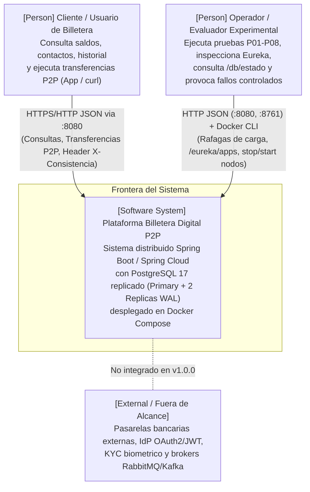

# 1. Vista de Contexto del Sistema (C4 · Nivel 1)

**Documentos relacionados:** [Índice del SAD](README.md) · [Propósito y Alcance en SRS](../srs/01-introduccion/01-proposito-alcance.md) · [Actores y Glosario](../srs/01-introduccion/02-glosario-actores.md)

---

## 1. Objetivo de la Vista

El **Nivel 1 del Modelo C4** ubica a la plataforma de **Billetera Digital y Transferencias P2P** como una caja negra frente a los usuarios y operadores que interactúan con ella, delimitando con precisión qué queda dentro del perímetro del sistema y qué queda explícitamente fuera de alcance.

---

## 2. Diagrama C4 Nivel 1 — Contexto del Sistema

---

## 3. Actores e Interacciones en la Frontera

| Actor / Sistema | Tipo | Canal / Protocolo | Interacciones Principales |
|---|---|---|---|
| **Cliente / Usuario de Billetera** | Persona (vía App o `curl`) | HTTP/JSON (`:8080`) | Consultar perfil/saldo ordinario, listar contactos frecuentes, ejecutar transferencia P2P, verificar saldo crítico post-transferencia (`RYOW`), verificar comprobante e historial. |
| **Operador / Evaluador Experimental** | Persona / Script automatizado | HTTP (`:8080`, `:8761`) + Docker CLI | Verificar registro dinámico en Eureka, ejecutar ráfagas de 100+ peticiones (`P02`), detener/iniciar `ms-cuentas-2` (`P03`) y `replica1` (`P06`, `P08`), auditar `auditoriaTecnica` y `/api/*/db/estado`. |

---

## 4. Restricciones Arquitectónicas de Contexto

Según [Supuestos, Dependencias y Restricciones](../srs/02-descripcion-general/03-supuestos-dependencias.md), el diseño debe respetar sin excepciones:

1. **Punto único de entrada de negocio:** Todo tráfico funcional externo ingresa por `api-gateway` (`:8080`). Los puertos de microservicios (`8081`, `8082`, `8083`) y PostgreSQL (`5432`, `5433`, `5434`) se exponen únicamente para diagnóstico experimental (`P01–P08`).
2. **Prohibición de acceso SQL entre servicios:** Ningún componente externo ni servicio distinto de `ms-cuentas` accede al esquema `cuentas_db`, ni distinto de `ms-transacciones` accede a `tx_db`.
3. **Sin simulación de replicación ni enrutamiento:** Las réplicas deben ser instancias PostgreSQL 17 reales con *streaming WAL* físico y el enrutamiento JDBC debe realizarse programáticamente mediante `AbstractRoutingDataSource`.
4. **Autosuficiencia del entorno:** La ejecución completa debe reproducirse con Docker Engine y Docker Compose v2 a partir de `.env` (derivado de `.env.example`), sin secretos reales versionados en Git.
