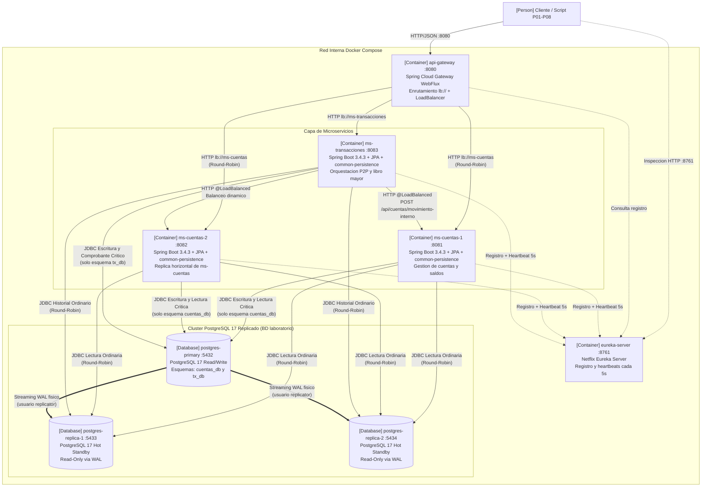

# 2. Vista de Contenedores (C4 · Nivel 2)

**Documentos relacionados:** [Índice del SAD](README.md) · [Nivel 1: Contexto](01-contexto-c4-nivel1.md) · [Perspectiva del Producto](../srs/02-descripcion-general/01-perspectiva-producto.md) · [Contratos REST](../srs/05-interfaces-y-datos/01-contratos-api-rest.md)

---

## 1. Objetivo de la Vista

El **Nivel 2 del Modelo C4** descompone la plataforma en sus **8 unidades desplegables en tiempo de ejecución** (contenedores Docker), explicitando sus responsabilidades, tecnologías, protocolos de comunicación y la frontera estricta entre el plano de descubrimiento HTTP y el plano de enrutamiento de base de datos.

---

## 2. Diagrama C4 Nivel 2 — Contenedores

---

## 3. Catálogo de Contenedores y Responsabilidades

| Contenedor | Puerto | Tecnología | Rol Principal | Persistencia / Estado |
|---|---|---|---|---|
| `eureka-server` | `8761` | Spring Cloud Netflix Eureka | Registro dinámico de servicios, recepción de *heartbeats* (`5s`) y expiración de *leases* (`12s`). | En memoria (efímero). |
| `api-gateway` | `8080` | Spring Cloud Gateway (WebFlux) + LoadBalancer | Puerta de enlace única, resolución `lb://`, reescritura `/api/*/db/{segment}` y agregado de `X-Gateway-Handled`. | Sin estado (*stateless*). |
| `ms-cuentas-1` | `8081` | Spring Boot `3.4.3`, Spring Data JPA, `common-persistence` | Gestión de billeteras, contactos frecuentes y débitos/créditos atómicos. | Esquema `cuentas_db` (vía rol `cuentas_user`). |
| `ms-cuentas-2` | `8082` | Spring Boot `3.4.3`, Spring Data JPA, `common-persistence` | Segunda instancia activa de `ms-cuentas` para balanceo HTTP (`P02`) y tolerancia a caída (`P03`). | Esquema `cuentas_db` (vía rol `cuentas_user`). |
| `ms-transacciones` | `8083` | Spring Boot `3.4.3`, Spring Data JPA, `RestClient`, `common-persistence` | Orquestación de transferencias P2P invocando a `lb://ms-cuentas`, emisión de comprobantes e historial. | Esquema `tx_db` (vía rol `tx_user`). |
| `primary` (`postgres-primary`) | `5432` | PostgreSQL `17` | Nodo maestro de lectura/escritura y fuente de lecturas críticas (*RYOW*). | Volumen `primary_data` (`wal_level=replica`). |
| `replica1` (`postgres-replica-1`) | `5433` | PostgreSQL `17` (*Hot Standby*) | Réplica física de solo lectura alimentada vía `pg_basebackup` + *streaming WAL*. | Volumen `replica1_data` (`hot_standby=on`). |
| `replica2` (`postgres-replica-2`) | `5434` | PostgreSQL `17` (*Hot Standby*) | Segunda réplica física de solo lectura para distribución Round-Robin y *failover* de lectura. | Volumen `replica2_data` (`hot_standby=on`). |

---

## 4. Dos Planos de Balanceo Ortogonales

Una decisión fundamental de esta arquitectura es mantener **estrictamente separados** dos mecanismos de descubrimiento y balanceo que cumplen propósitos distintos:

| Dimensión | Plano HTTP (Microservicios) | Plano JDBC (Base de Datos) |
|---|---|---|
| **Responsable** | `eureka-server` + `Spring Cloud LoadBalancer` | `common-persistence` (`CustomRoutingDataSource` + `ReplicaHealthTracker`) |
| **Objetivos balanceados** | Instancias de `ms-cuentas` (`8081`, `8082`) y `ms-transacciones` (`8083`) | Pools `HikariDataSource` hacia `PRIMARY`, `REPLICA_1` y `REPLICA_2` |
| **Criterio de selección** | Registro Eureka en estado `UP` + Round-Robin de LoadBalancer | Anotación `@UsarNodo`, cabecera `X-Consistencia: CRITICA`, salud de réplicas y Round-Robin |
| **Frontera** | Eureka **nunca** registra nodos PostgreSQL | `common-persistence` **nunca** consulta a Eureka |
