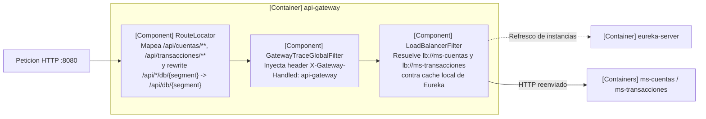
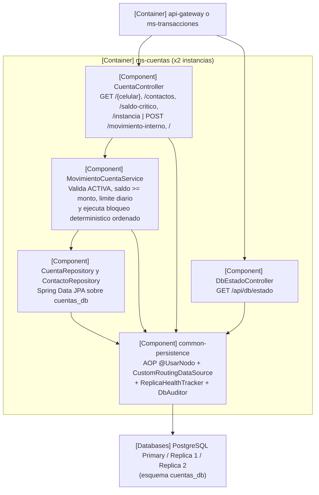
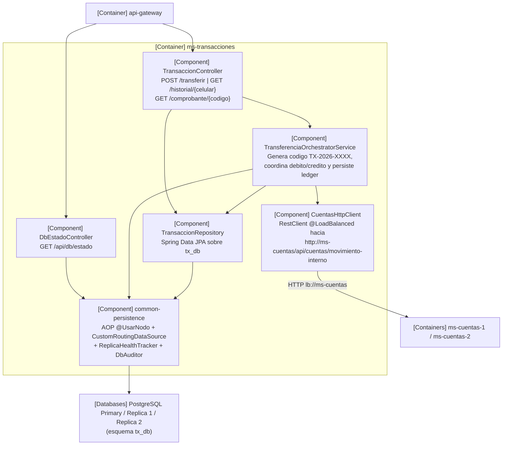
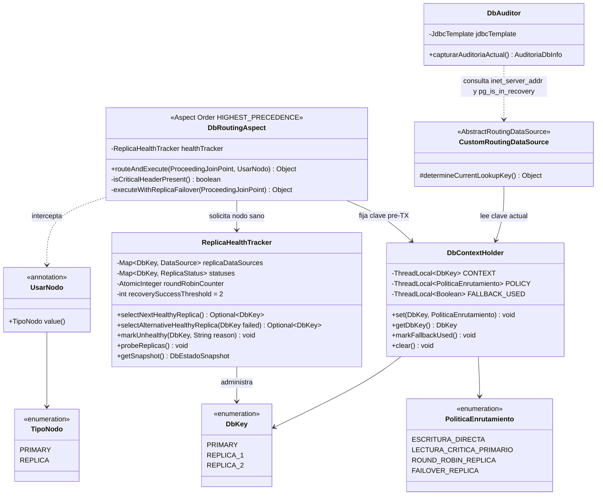

# 3. Vista de Componentes y Código (C4 · Niveles 3 y 4)

**Documentos relacionados:** [Índice del SAD](README.md) · [Nivel 2: Contenedores](02-contenedores-c4-nivel2.md) · [Vistas Dinámicas](04-vistas-dinamicas-y-estados.md) · [Modelo de Datos](../srs/05-interfaces-y-datos/02-modelo-datos-esquemas.md)

---

## 1. Vista de Componentes de `api-gateway` (C4 Nivel 3)

### Rutas lógicas configuradas
- `/api/cuentas/db/{segment}` → `lb://ms-cuentas` con filtro `SetPath=/api/db/{segment}`
- `/api/cuentas/**` → `lb://ms-cuentas`
- `/api/transacciones/db/{segment}` → `lb://ms-transacciones` con filtro `SetPath=/api/db/{segment}`
- `/api/transacciones/**` → `lb://ms-transacciones`

---

## 2. Vista de Componentes de `ms-cuentas` (C4 Nivel 3)

---

## 3. Vista de Componentes de `ms-transacciones` (C4 Nivel 3)

---

## 4. Vista de Componentes y Código de `common-persistence` (C4 Niveles 3 y 4)

`common-persistence` es el módulo Maven compartido que encapsula toda la complejidad de CQRS ligero, enrutamiento JDBC, detección de fallos y auditoría real de nodo PostgreSQL.

### Diagrama de Clases (C4 Nivel 4)

### Invariantes de diseño en `common-persistence`
1. **Precedencia estricta de AOP:** `DbRoutingAspect` lleva `@Order(Ordered.HIGHEST_PRECEDENCE)` para ejecutarse **antes** de `TransactionInterceptor` (`@Transactional`).
2. **Desactivación de OSIV:** `spring.jpa.open-in-view=false` en ambos microservicios para impedir que el *EntityManager* tome una conexión desde `PRIMARY` antes de entrar a la capa de servicio anotada con `@UsarNodo`.
3. **Limpieza garantizada:** `DbContextHolder.clear()` se ejecuta siempre en un bloque `finally` dentro de `DbRoutingAspect` para evitar contaminación entre hilos reutilizados del pool servlet.
4. **Auditoría real por conexión:** `DbAuditor` ejecuta `SELECT inet_server_addr()::text, inet_server_port(), pg_is_in_recovery()` dentro del mismo contexto de enrutamiento de la operación para construir `auditoriaTecnica` y los encabezados `X-Db-Node` / `X-Db-Fallback`.
