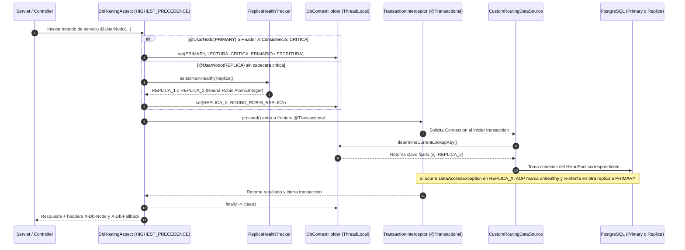
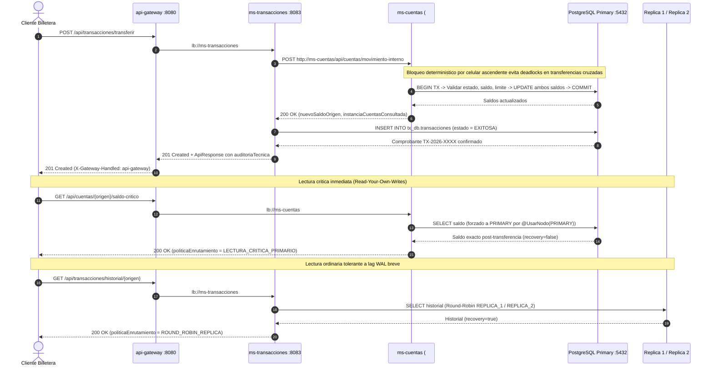
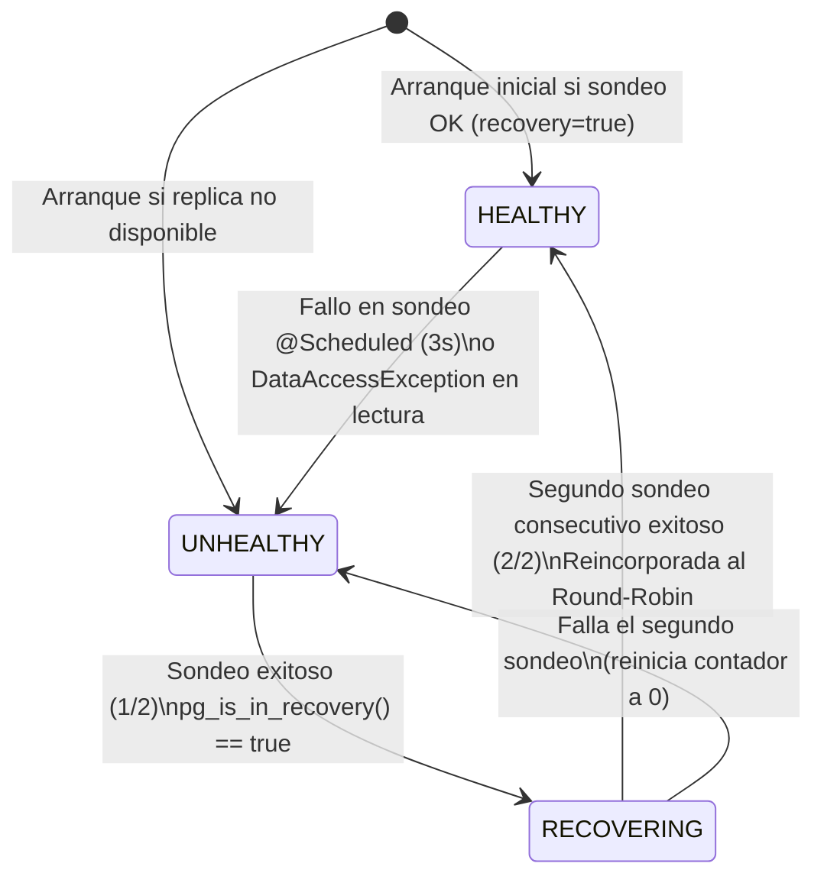

# 4. Vistas Dinámicas, Concurrencia y Estados

**Documentos relacionados:** [Índice del SAD](README.md) · [Componentes Nivel 3 y 4](03-componentes-c4-nivel3.md) · [Flujos de Secuencia en SRS](../srs/05-interfaces-y-datos/03-flujos-secuencia.md) · [Criterios P01–P08](../srs/06-verificacion-y-trazabilidad/01-criterios-aceptacion-p01-p08.md)

---

## 1. Vista Dinámica — Interceptación AOP Pre-Transaccional

Este flujo explica el mecanismo interno que evita que Spring/Hibernate adquiera una conexión JDBC antes de seleccionar el nodo correcto (`PRIMARY`, `REPLICA_1` o `REPLICA_2`).

---

## 2. Vista Dinámica — Transferencia P2P (`P04`) y Consistencia RYOW (`P07`)

---

## 3. Máquina de Estados — Ciclo de Salud de Réplicas (`ReplicaHealthTracker`)

Para cumplir con `RNF-03` y `RNF-04` (`P06` y `P08`), cada réplica (`REPLICA_1`, `REPLICA_2`) sigue una máquina de estados finita administrada por `ReplicaHealthTracker`:

### Reglas de transición y *Failover*
1. **Degradación inmediata (`HEALTHY -> UNHEALTHY`):** Puede dispararse de forma **proactiva** por el sondeo `@Scheduled(fixedDelay = 3000)` (`connectionTimeout = 2000ms`, `queryTimeout = 2s`) o de forma **reactiva** dentro de `DbRoutingAspect` si una consulta real falla antes del siguiente ciclo de sondeo.
2. **Rescate en la misma petición (*Failover pasivo*):** Cuando `DbRoutingAspect` captura `DataAccessException` o `TransactionException` en una lectura dirigida a `REPLICA_X`, marca `REPLICA_X` como `UNHEALTHY`, selecciona la réplica alternativa sana (o `PRIMARY` si ambas réplicas están caídas), marca `X-Db-Fallback: true` y reintenta la operación de lectura de manera transparente para el cliente.
3. **Reincorporación segura (`UNHEALTHY -> RECOVERING -> HEALTHY`):** Se exige que PostgreSQL responda a SQL (`pg_is_in_recovery() == true` y reporte `pg_last_wal_replay_lsn()`) durante **2 sondeos consecutivos** (`recoverySuccessThreshold = 2`), evitando enviar tráfico a una réplica que apenas abrió su socket TCP mientras termina de iniciar o recuperar WAL.

---

## 4. Concurrencia y Prevención de *Deadlocks* en `ms-cuentas`

Cuando dos usuarios ejecutan transferencias simultáneas opuestas (`A -> B` y `B -> A`), adquirir bloqueos `SELECT ... FOR UPDATE` en orden distinto produciría un interbloqueo (*deadlock*) en PostgreSQL.

**Estrategia arquitectónica en `MovimientoCuentaService`:**
- Antes de bloquear filas en `cuentas_db.cuentas`, los identificadores `celularOrigen` y `celularDestino` se ordenan lexicográficamente (`menor`, `mayor`).
- La transacción adquiere el bloqueo pesimista siempre primero sobre `menor` y luego sobre `mayor`, garantizando un orden global acíclico de locks dentro de `PRIMARY`.
- Al ejecutarse sobre `PRIMARY` bajo `@Transactional`, se mantiene la atomicidad ACID sin necesidad de coordinadores distribuidos 2PC/XA entre microservicios.
