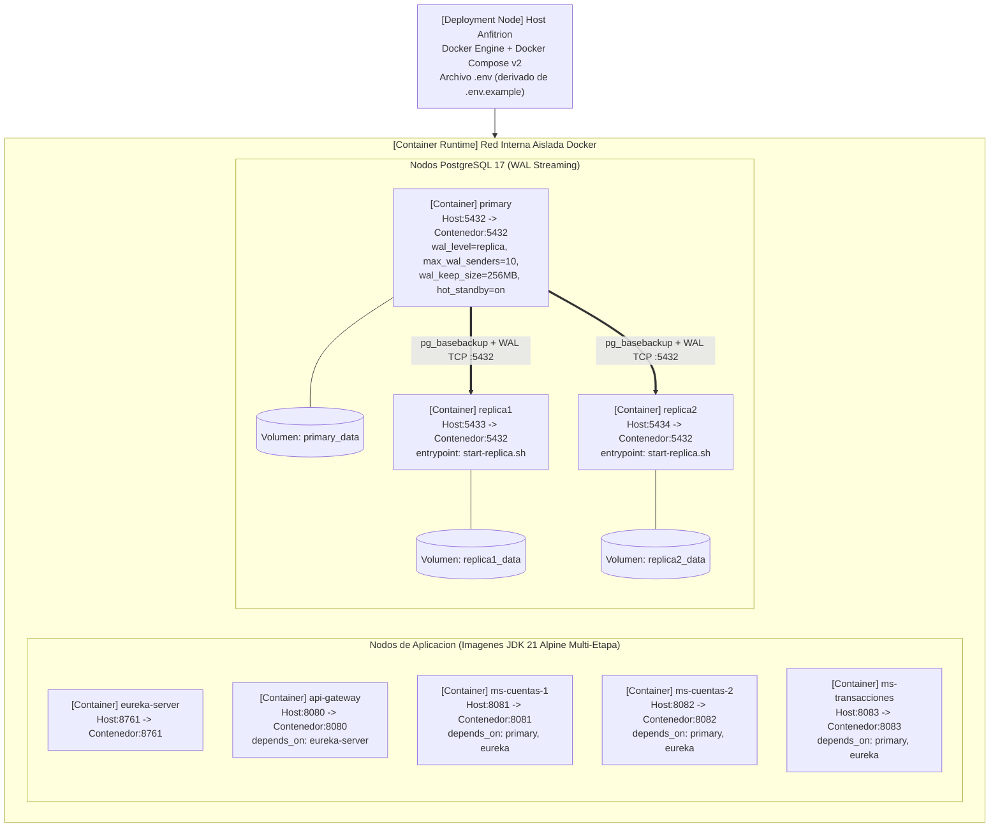
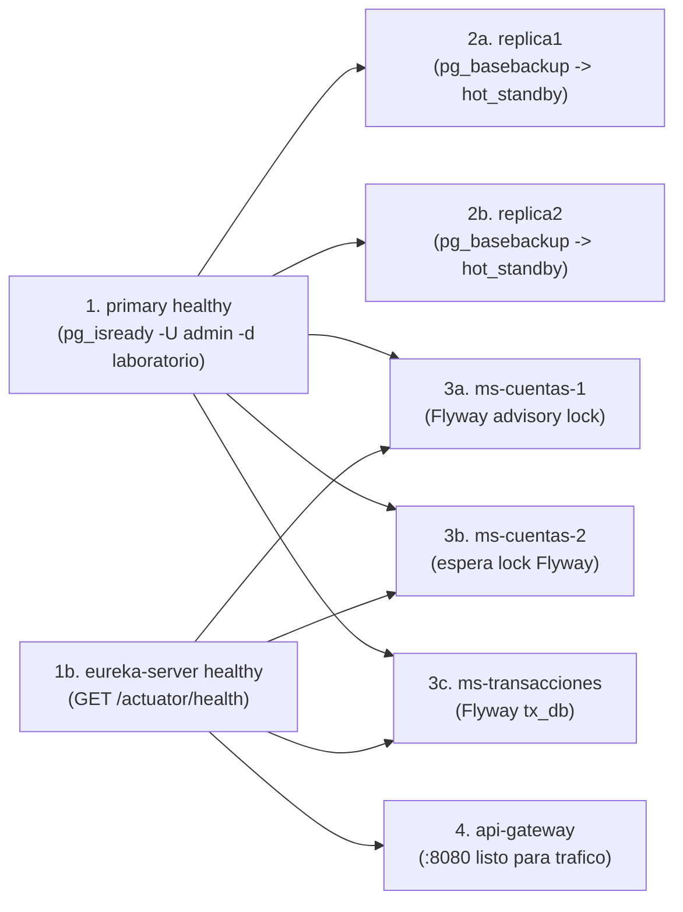

# 5. Vista de Despliegue e Infraestructura (C4 · Deployment)

**Documentos relacionados:** [Índice del SAD](README.md) · [Nivel 2: Contenedores](02-contenedores-c4-nivel2.md) · [Docker Compose](../../docker-compose.yml) · [Script Primario](../../primary-init.sh) · [Script Réplica](../../start-replica.sh)

---

## 1. Diagrama C4 de Despliegue (Entorno Docker Compose)

---

## 2. Secuencia de Arranque y Dependencias (`depends_on` + `healthcheck`)

Para cumplir con `RNF-10` (reproducibilidad limpia en un solo comando `docker compose up -d --build`), la orquestación impone un grafo de dependencias determinístico:

### Protección contra condiciones de carrera en arranque
- **Base de datos:** `primary-init.sh` crea el rol `replicator` con autenticación `scram-sha-256` e inicializa esquemas/roles de aplicación (`cuentas_db`/`cuentas_user`, `tx_db`/`tx_user`). `start-replica.sh` espera en bucle hasta que `pg_basebackup` complete una copia física limpia si `$PGDATA/PG_VERSION` no existe.
- **Microservicios duplicados (`ms-cuentas-1` y `ms-cuentas-2`):** Como ambas instancias arrancan en paralelo apuntando al mismo esquema `cuentas_db` en `primary`, el versionamiento de tablas y datos semilla se gestiona mediante **Flyway** (`@FlywayDataSource` sobre `PRIMARY`), el cual utiliza internamente un **PostgreSQL *advisory lock*** para garantizar que una sola instancia aplique las migraciones (`V1__`, `V2__`) y la segunda valide sin errores de unicidad ni condiciones de carrera.

---

## 3. Seguridad y Parametrización de Entorno (`RNF-09`)

- **Compilación autocontenida:** Cada servicio Java se construye mediante `Dockerfile` multi-etapa (`maven:3.9-eclipse-temurin-21-alpine` en fase *build* → `eclipse-temurin:21-jre-alpine` en fase *runtime*), eliminando la dependencia de JDK/Maven en el host.
- **Externalización de secretos:** Las credenciales (`POSTGRES_PASSWORD`, `REPLICATION_PASSWORD`, `CUENTAS_DB_PASSWORD`, `TX_DB_PASSWORD`) se definen en `.env` (ignorado en `.gitignore`) y se documentan con valores plantilla en `.env.example`.
- **Principio de mínimo privilegio en SQL:**
  - `cuentas_user` solo tiene privilegios sobre `cuentas_db`.
  - `tx_user` solo tiene privilegios sobre `tx_db`.
  - `replicator` posee únicamente permiso `REPLICATION LOGIN` para transmisión WAL.
