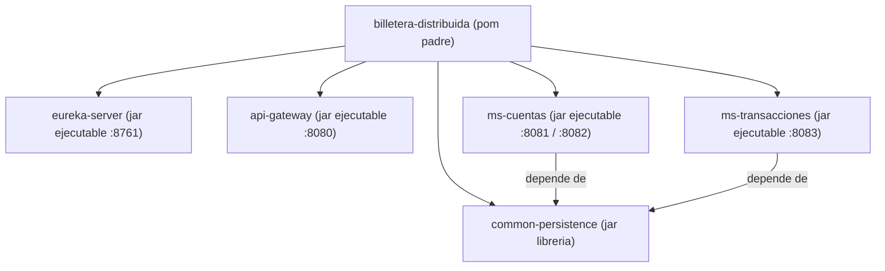

# Documento de Diseño de Software (SDD)
## Sistema Distribuido de Billetera Digital y Transferencias P2P (*Fintech*)

**Estándar de referencia:** IEEE Std 1016-2009 (*Software Design Descriptions*)  
**Versión del documento:** `1.0.0`  
**Fecha:** `2026-11-18`  
**Stack objetivo:** Java 21 LTS · Spring Boot `3.4.3` · Spring Cloud `2024.0.1` · PostgreSQL `17` · Docker Compose  
**Documentos hermanos:** [SRS (IEEE 29148)](../srs/README.md) · [SAD (Modelo C4 + ADRs)](../sad/README.md) · [API REST (`curl` + OpenAPI)](../api/README.md)

---

## 1. Propósito del Documento

Este **Documento de Diseño de Software (SDD)** traduce la especificación de requisitos ([SRS](../srs/README.md)) y la arquitectura del sistema ([SAD](../sad/README.md)) en **especificaciones detalladas de implementación**: estructura de módulos Maven, contratos Java exactos, algoritmos de enrutamiento y concurrencia, entidades JPA, índices SQL, configuración de Spring Boot/Cloud y artefactos de despliegue Docker.

---

## 2. Estructura Modular del SDD

| Módulo | Foco de Diseño | Contenido Principal | Documento |
|---|---|---|---|
| **01 · Estructura de Proyectos y Paquetes** | Organización del código | `pom.xml` multi-módulo, árbol de paquetes Java y perfiles de configuración | [01-estructura-proyectos-y-paquetes.md](01-estructura-proyectos-y-paquetes.md) |
| **02 · Diseño de `common-persistence`** | Núcleo transversal JDBC/AOP | Firmas exactas, algoritmos de `DbRoutingAspect`, `ReplicaHealthTracker`, `DbAuditor` y `ApiResponse<T>` | [02-diseno-common-persistence.md](02-diseno-common-persistence.md) |
| **03 · Diseño de `ms-cuentas`** | Dominio Billetera y Saldos | Entidades JPA, repositorios con bloqueo pesimista, servicio atómico anti-*deadlock* y DTOs | [03-diseno-ms-cuentas.md](03-diseno-ms-cuentas.md) |
| **04 · Diseño de `ms-transacciones`** | Orquestación P2P y Ledger | Entidad `Transaccion`, `CuentasHttpClient` `@LoadBalanced`, orquestador y manejo de errores `503`/`409` | [04-diseno-ms-transacciones.md](04-diseno-ms-transacciones.md) |
| **05 · Diseño de `api-gateway` y `eureka-server`** | Borde y Descubrimiento | Rutas `lb://`, `GatewayTraceGlobalFilter`, parámetros de *lease* y caché de Eureka | [05-diseno-gateway-y-eureka.md](05-diseno-gateway-y-eureka.md) |
| **06 · Diseño de Base de Datos, Versionamiento y Semillas** | Persistencia PostgreSQL 17 | Migraciones Flyway (`V1__`, `V2__`), roles disjuntos, índices, *advisory lock* y datos iniciales | [06-diseno-bd-migraciones-y-datos-semilla.md](06-diseno-bd-migraciones-y-datos-semilla.md) |
| **07 · Diseño de Docker, `.env` y Pruebas `P01–P08`** | Empaquetado y Verificación | `Dockerfile` multi-etapa, `.env.example`, `docker-compose.yml` completo y scripts de prueba | [07-diseno-docker-env-y-verificacion.md](07-diseno-docker-env-y-verificacion.md) |

---

## 3. Mapa de Dependencias entre Módulos Maven

> **Regla de acoplamiento:** `api-gateway` y `eureka-server` **no** dependen de `common-persistence` ni de JDBC/PostgreSQL; únicamente `ms-cuentas` y `ms-transacciones` incorporan el starter/librería `common-persistence`.
