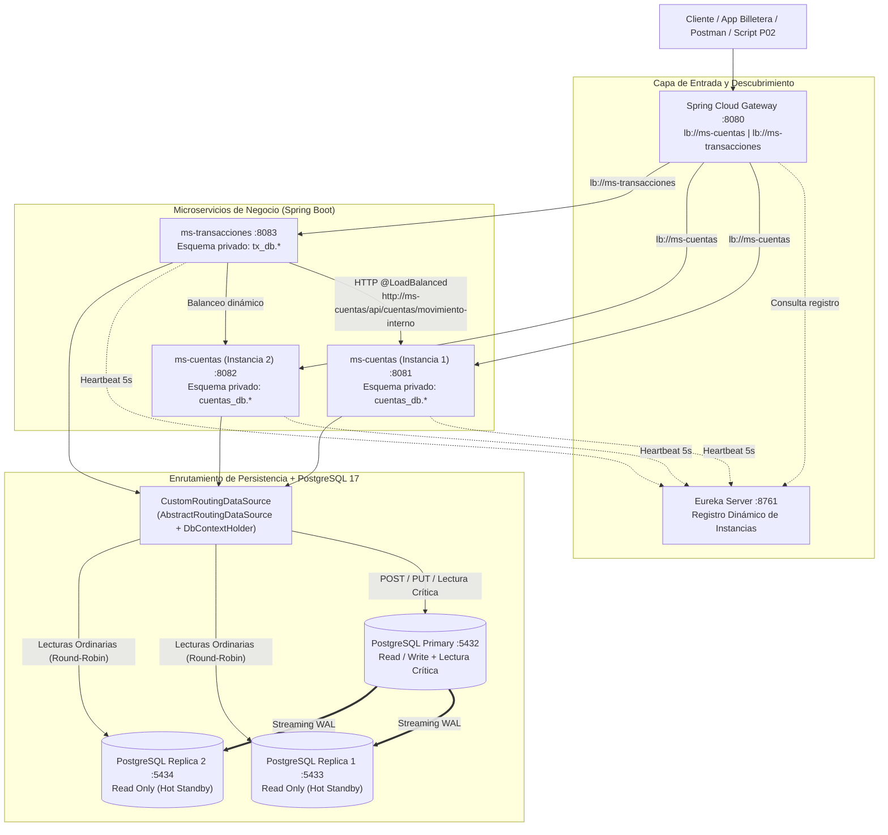

# 2.1 Perspectiva del Producto y Topología

## 1. Contexto Arquitectónico

El sistema opera como una arquitectura de microservicios autocontenida en contenedores Docker interconectados por una red privada, exponiendo un único punto de entrada HTTP para clientes (`api-gateway:8080`) y un tablero de descubrimiento (`eureka-server:8761`).

---

## 2. Separación de Responsabilidades

1. **Descubrimiento HTTP (`eureka-server` + `Spring Cloud LoadBalancer`):** Administra exclusivamente el ciclo de vida y localización dinámica de los microservicios (`ms-cuentas`, `ms-transacciones`).
2. **Enrutamiento de Base de Datos (`CustomRoutingDataSource` + `ReplicaHealthTracker`):** Administra exclusivamente la selección entre el nodo Primario y las dos Réplicas PostgreSQL. Eureka nunca registra ni balancea nodos de base de datos.
3. **Propiedad de Datos (*Database-per-Service*):** `ms-cuentas` solo define entidades JPA sobre el esquema `cuentas_db` y `ms-transacciones` solo sobre `tx_db`, respaldado por usuarios PostgreSQL con permisos separados.
