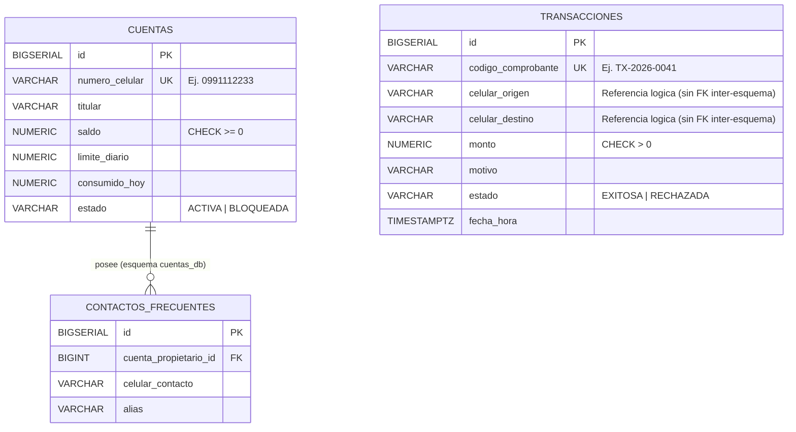

# 5.2 Modelo de Datos y Aislamiento de Esquemas

## 1. Diagrama Entidad-Relación por Servicio

Aunque ambos microservicios residen sobre el mismo clúster físico PostgreSQL 17 replicado (`laboratorio`), **sus esquemas y usuarios están completamente aislados** para impedir el acoplamiento a tablas privadas ajenas.



> **Nota arquitectónica:** `TRANSACCIONES` (`tx_db`) referencia a las cuentas únicamente por `celular_origen` y `celular_destino` como identificadores de negocio, sin claves foráneas SQL hacia `cuentas_db.cuentas`.

---

## 2. DDL Conceptual y Permisos PostgreSQL

```sql
-- Esquema y rol exclusivo de ms-cuentas
CREATE ROLE cuentas_user WITH LOGIN PASSWORD '<SECRETO_EN_ENV>';
CREATE SCHEMA IF NOT EXISTS cuentas_db AUTHORIZATION cuentas_user;

CREATE TABLE cuentas_db.cuentas (
    id BIGSERIAL PRIMARY KEY,
    numero_celular VARCHAR(20) NOT NULL UNIQUE,
    titular VARCHAR(120) NOT NULL,
    saldo NUMERIC(14, 2) NOT NULL CHECK (saldo >= 0),
    limite_diario NUMERIC(14, 2) NOT NULL CHECK (limite_diario > 0),
    consumido_hoy NUMERIC(14, 2) NOT NULL DEFAULT 0.00,
    estado VARCHAR(20) NOT NULL DEFAULT 'ACTIVA'
);

CREATE TABLE cuentas_db.contactos_frecuentes (
    id BIGSERIAL PRIMARY KEY,
    cuenta_propietario_id BIGINT NOT NULL REFERENCES cuentas_db.cuentas(id),
    celular_contacto VARCHAR(20) NOT NULL,
    alias VARCHAR(80) NOT NULL
);

-- Esquema y rol exclusivo de ms-transacciones
CREATE ROLE tx_user WITH LOGIN PASSWORD '<SECRETO_EN_ENV>';
CREATE SCHEMA IF NOT EXISTS tx_db AUTHORIZATION tx_user;

CREATE TABLE tx_db.transacciones (
    id BIGSERIAL PRIMARY KEY,
    codigo_comprobante VARCHAR(40) NOT NULL UNIQUE,
    celular_origen VARCHAR(20) NOT NULL,
    celular_destino VARCHAR(20) NOT NULL,
    monto NUMERIC(14, 2) NOT NULL CHECK (monto > 0),
    motivo VARCHAR(160) NOT NULL,
    estado VARCHAR(20) NOT NULL,
    fecha_hora TIMESTAMPTZ NOT NULL DEFAULT NOW()
);
```
