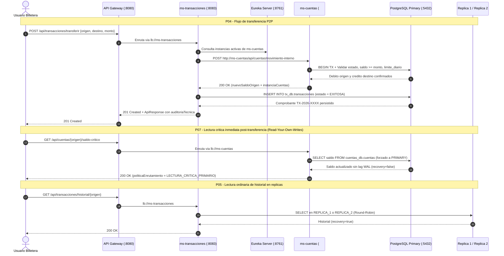
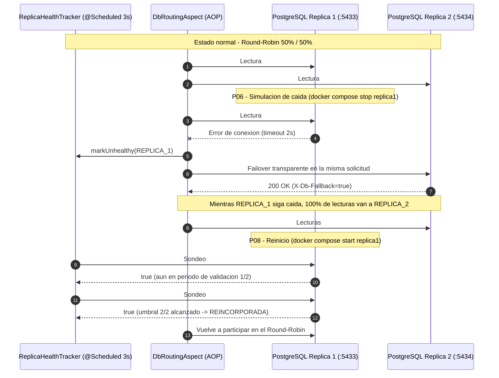

# 5.3 Flujos de Secuencia Críticos

## 1. Transferencia P2P Inter-Servicios (P04) y Lectura Crítica Inmediata (P07)

---

## 2. Tolerancia a Fallos y Reincorporación Segura de Réplica (P06 y P08)

